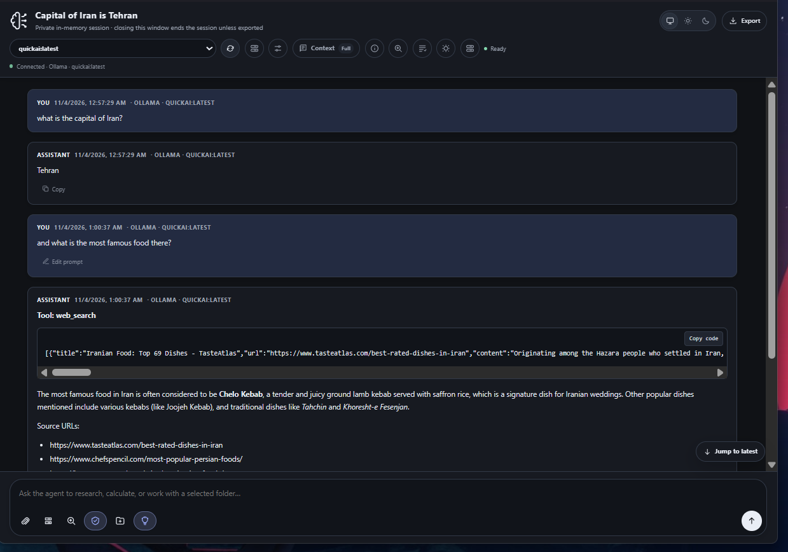

<p align="center">
  
</p>

<h1 align="center">RunMind</h1>

<p align="center">
  <strong>Your local-first AI workspace for Windows.</strong><br />
  Project-aware assistance, research, developer workflows and Windows system tools — in one desktop workspace.
</p>

<p align="center">
  <strong>Version 3.4.1</strong> · Windows 11 x64 · .NET 10 · C# and JavaScript · MIT License
</p>

<p align="center">
  <a href="./docs/getting-started/BUILD-AND-SETUP.md">Build &amp; setup</a> ·
  <a href="./docs/README.md">Documentation</a> ·
  <a href="./CHANGELOG.md">Changelog</a> ·
  <a href="./ROADMAP.md">Roadmap</a>
</p>

---

RunMind connects the model provider you choose — local or remote — to a shared Agent workspace that can understand a selected project, gather research evidence, assist with development tasks, produce useful files, and operate supported Windows features through explicit permissions and confirmations.

It is designed to work with local model servers such as **Ollama** and **LM Studio**, while remaining compatible with configured OpenAI-compatible endpoints and remote integrations. RunMind itself is a Windows desktop application; local inference does not make every optional integration offline.

> **Release status — 3.4.1:** Host and package version metadata is aligned across all four hosts. This is a source release snapshot, not a claim of completed Windows certification. Build, install, WebView2, PowerToys, MSIX and native-action acceptance must still be completed on the target Windows installation. See [Build and validation status](./docs/project/BUILD-STATUS.md).

## At a glance

| Area | What RunMind provides |
|---|---|
| **Project-aware Agent** | Workspace indexing, project understanding, bounded file operations, Git-aware review, change-impact analysis, checkpoints and recovery review. |
| **Deep Research** | Research plans, SearXNG search, source retrieval, evidence excerpts, model-assisted claim/source assessment and Markdown export. |
| **Developer workflows** | Node.js debugging/profiling, Playwright browser workflows, API/OpenAPI testing, development-server management and SQLite inspection. |
| **Windows System Manager** | Permission-controlled application, process, service, task, event, network, storage, security and container operations. |
| **Live Resource Intelligence** | User-started CPU, memory, GPU, network and process-I/O sampling with in-memory charts and export. |
| **Process Intelligence** | On-demand process details and separately confirmed close, terminate and guarded restart actions for eligible processes. |
| **Files and deliverables** | Markdown/HTML, DOCX, XLSX, text-oriented PDF, SVG charts/diagrams, Mermaid source, SVG QR codes, image galleries and WebP thumbnails. |

## See RunMind

The repository includes real product captures from earlier development iterations. They are kept here as visual references rather than represented as pixel-current 3.4.1 screenshots; some launcher captures still show the predecessor **LocalLLM** label. The source archive does not contain a fresh, Windows-captured 3.4.1 screenshot set.

### Workspace and Agent



*Earlier workspace capture. The 3.4.1 codebase continues the shared workspace and Agent experience; exact layout and labels may differ.*

### Launcher and quick-answer experience — historical captures


*These three captures predate the RunMind rebrand and are included for historical UI context. They are not screenshots of a verified 3.4.1 Windows installation.*

## The four Windows hosts

RunMind has four entry points. The first three host the **Full Agent** and share the canonical ChatWindow/Agent implementation and native bridge. **Runner** is intentionally a separate, restricted Quick Host.

| Host | Full Agent | Workspace and developer tools | System Manager | Purpose |
|---|:---:|:---:|:---:|---|
| **Standalone** | Yes | Yes | Yes | Full native Windows desktop workspace. |
| **PowerToys Run** | Yes | Yes | Yes | Launch the Full Agent from PowerToys Run; `llm <prompt>` also requests an inline model answer. |
| **Command Palette** | Yes | Yes | Yes | Inline model answers, RunMind Dock conversation and the Command Palette package's own full RunMind chat window. |
| **RunMind Runner** | No | No | No | Lightweight launcher for apps, files/folders, URLs, calculator expressions and inline model answers. |

Runner does not expose workspace access, file attachments, developer tools, MCP, Skills or System Manager. When a task needs the Full Agent, Runner hands off to the actual Standalone application. Its current launcher registry is first-party-only; it is not a public third-party plugin SDK or arbitrary plugin loader.

## Core capabilities

### Project-aware Agent

Select a local workspace and ask the Agent to inspect and work with project context. Available workflows include project understanding and diagnostics, Git review, bounded file operations, development intelligence, and the **Change Impact Explorer**.

Change Impact Explorer correlates Git changes with supported symbols, imports, reverse dependencies, local asset references, candidate tests and available coverage evidence. Its risk and confidence output is evidence-based and heuristic: it cannot discover every runtime dependency, execute the suggested tests, or prove that a change is safe. Review its evidence and limitations in the [Change Impact Explorer guide](./docs/product/CHANGE-IMPACT-EXPLORER-V2.md).

Agent workflows can use installed Skills, connected MCP servers, native Windows capabilities and supported developer integrations. Task checkpoints and the Development Session Timeline preserve local progress evidence; uncertain side effects are not automatically replayed.

### Deep Research

Deep Research can build and revise a plan, search a configured SearXNG instance, retrieve source pages, capture evidence excerpts, perform model-assisted claim/source assessments, pause or resume work, and export a Markdown report. Exact-quote matching checks whether an excerpt occurs in retrieved text; it does not independently establish that a claim is true or that a source is reliable.

### Developer workflows

Available integrations include Node.js debugging and runtime profiling, Playwright browser automation, API/OpenAPI testing, development-server lifecycle management and SQLite inspection. Each integration depends on its local runtime, project dependencies, browser and permissions. Playwright runs use a fresh browser context and do not persist login state.

### Windows System Manager

System Manager exposes supported Windows operations for applications/startup entries, processes, services, scheduled tasks, event/crash records, network diagnostics, storage health, security posture, application adapters and containers. Docker and Podman operations require a compatible runtime to be installed and available on `PATH`.

System Manager is disabled by default. Native operations re-check their permission/capability when dispatched, and state-changing operations require their applicable confirmation. Approved commands run with the current Windows account's permissions; RunMind does not silently elevate and is not a security sandbox.

### Live Resource and Process Intelligence

Live Resource Intelligence is an explicitly started, bounded monitoring session. It samples CPU, memory, GPU, network and process I/O; samples remain in memory for that session and can be exported by the user. It is not an always-on monitoring service. GPU readings depend on the counters exposed by the installed driver.

Process Intelligence provides on-demand process inspection and separately confirmed close, terminate and guarded restart actions for eligible processes. Service-hosted and protected processes are blocked from process-level control. Restart does not recreate the original process token, working directory, inherited handles or application state.

### Files and deliverables

The Agent can create Markdown/HTML, structured Word DOCX documents, Excel XLSX workbooks, text-oriented PDFs, SVG charts and diagrams, Mermaid diagram source, SVG QR codes, HTML image galleries and WebP thumbnails from workspace images. These are bounded generators, not full Microsoft Office editors or a general-purpose image-generation system. PDF output is text-focused and does not render embedded images or complex page layouts.

## Models and integrations

| Provider or integration | Support in this source |
|---|---|
| **Ollama** | Local model server; default API URL `http://localhost:11434`. |
| **LM Studio** | OpenAI-compatible chat completions or LM Studio Native REST v1; default OpenAI-compatible base URL `http://localhost:1234/v1`. |
| **OpenAI-compatible endpoints** | Additional local or hosted endpoints configured by the user. |
| **SearXNG** | Optional web discovery for Agent tools and multi-query Deep Research; configure an instance URL to enable it. |
| **MCP** | Remote tools, resources, resource templates and prompts over Streamable HTTP. STDIO transport is not implemented. Remote operations require approval. |

Vision, tool calling, reasoning features, context length and other model behaviors depend on the selected model, server and API mode. Prompts, queries, page requests or tool arguments may be sent to configured remote providers, search services, MCP servers, websites and browser workflows.

## Security and privacy

- Workspace operations are scoped to the selected workspace and apply validation, approval and recovery rules. This does not sandbox arbitrary native execution.
- System Manager is disabled by default; native operations re-check the relevant capability and state-changing operations require confirmation.
- PowerShell and native process commands run with the current Windows account's permissions. RunMind does not silently elevate.
- MCP responses, Skills, repository instructions and adapter metadata are untrusted content. They cannot grant permissions or override native policy. Skill scripts are not automatically executed.
- **Credential storage is not uniform across hosts.** Full Chat provider/Jina/Reader/MCP secrets and shared PowerToys Run/Command Palette inline credentials are stored in local WebView2 or per-user JSON settings without DPAPI encryption by RunMind. Runner inline credentials use Windows DPAPI CurrentUser protection. Read the [Security and Privacy guide](./docs/security/SECURITY-AND-PRIVACY.md) before storing sensitive credentials.

## Build and run

### Requirements

- Windows 11 x64, build 22621 or later. The provided release pipeline targets x64; ARM64 is not packaged.
- .NET 10 SDK and Windows x64 targeting/runtime packs.
- .NET 10 Desktop Runtime for the framework-dependent Standalone and Runner publications.
- Microsoft Edge WebView2 Runtime.
- Node.js 24 or later for the JavaScript regression suite and Node-based developer integrations.
- Git for Windows on `PATH` for Git-backed project tools.
- Microsoft PowerToys for the PowerToys Run plugin and Command Palette extension only.
- Ollama, LM Studio or another supported model endpoint for model features. SearXNG is optional and required for web search discovery.

### Build all four hosts

From the repository root on Windows, run:

```bat
Build-Release-x64.bat
```

The script prepares PDF/OCR runtime assets, restores and builds all four x64 host projects, publishes the framework-dependent Standalone and Runner applications, and packages/signs the Command Palette MSIX using the local development certificate. It does **not** install the hosts. The initial PDF.js/Tesseract preparation downloads packages and English/Persian language data, so the first build requires internet access. Those downloads are not yet fully pinned and hash-verified for reproducible offline builds.

After a successful build:

- Run Standalone from `Release\Standalone\win-x64\publish\RunMind.exe`.
- Install PowerToys Run with `Install-RunMind-PowerToys-Run.bat`.
- Install the Command Palette MSIX with `Install-RunMind-CommandPalette.bat`.
- Install Runner for the current user with `Install-RunMind-Runner.ps1`.

For exact prerequisites, outputs, installation behavior, OCR asset preparation, model-server CORS setup and validation commands, follow the [Build and Setup guide](./docs/getting-started/BUILD-AND-SETUP.md).

### Run the portable regression suite

With Node.js 24 or later installed, run:

```powershell
node --test --test-concurrency=1
```

For the Windows release build and output checks, run:

```powershell
.\Validate-RunMind-Windows.ps1
```

The validation script builds and checks release outputs; it does not install hosts or replace manual Windows acceptance. See [Build and Validation Status](./docs/project/BUILD-STATUS.md).

## Versioning

**Current source version: `3.4.1`.** The four host projects use `3.4.1`; the PowerToys Run plugin and Runner installer metadata use `3.4.1`; MCP client identification reports `3.4.1`; and the Command Palette MSIX project/package identity uses `3.4.1.0`. The MSIX's four-part format is the Windows package equivalent of the three-part product version.

Version metadata alignment is covered by a regression test. Generated assembly/package metadata and actual Windows installation/update behavior still require verification on Windows.

## Documentation

- [Build and setup](./docs/getting-started/BUILD-AND-SETUP.md) — prerequisites, build, host installation, model-server setup and validation.
- [Documentation index](./docs/README.md) — all maintained product, developer, System Manager, Runner and security guides.
- [Feature matrix](./docs/product/FEATURE-MATRIX.md) — host capabilities and implementation boundaries.
- [Agent capabilities](./docs/product/AGENT-CAPABILITIES.md) — Agent tools, policies, MCP, Skills and artifact verification.
- [Advanced intelligence and extensibility](./docs/product/ADVANCED-INTELLIGENCE-AND-EXTENSIBILITY.md) — Change Impact Explorer, Development Session Timeline, System Intelligence and orchestration.
- [System Manager operations](./docs/system/SYSTEM-MANAGER-OPERATIONS.md) — Windows operations, scheduled tasks and container controls.
- [Live Resource Intelligence](./docs/LIVE-RESOURCE-INTELLIGENCE.md) and [Process Intelligence](./docs/system/PROCESS-INTELLIGENCE.md) — monitoring and process inspection/actions.
- [Runner implementation](./docs/runner/RUNNER-IMPLEMENTATION.md) — restricted host scope, search pipeline and Standalone handoff.
- [Security and privacy](./docs/security/SECURITY-AND-PRIVACY.md) — credential storage, data flows and execution boundaries.
- [Build and validation status](./docs/project/BUILD-STATUS.md) — current checks and outstanding Windows release gates.
- [RunMind 3.4.1 release notes](./docs/releases/3.4.1-RELEASE-NOTES.md) · [3.4.0 release notes](./docs/releases/3.4.0-RELEASE-NOTES.md) · [Changelog](./CHANGELOG.md).
- [Roadmap](./ROADMAP.md) — remaining priorities and future candidates.
- [Historical archive](./docs/archive/README.md) — milestone audits, acceptance checklists and historical validation reports.

## License

RunMind is provided under the [MIT License](./LICENSE.txt).
