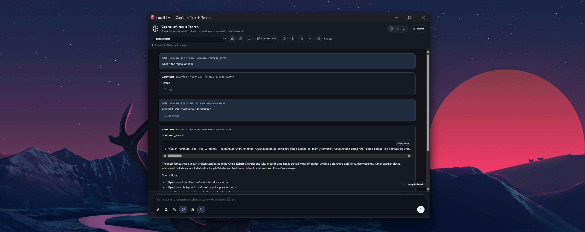

# RunMind

RunMind brings local and OpenAI-compatible language models to **PowerToys Run** and a standalone Windows chat app. It includes chat, Agent Mode, Deep Research, web search, and MCP tools.


## Features

- Ollama, LM Studio, and additional OpenAI-compatible model servers.
- Multiple model connections with optional API keys and custom authentication headers.
- Agent Mode with workspace files, tool use, and user-approved actions.
- Deep Research with editable plans, sources, checkpoints, and report export.
- Optional SearXNG web search, Jina Reader, custom Reader gateways, and MCP Streamable HTTP servers.
- Multiple independent chat windows from PowerToys Run and the standalone app.
- Save conversations as `.runmind` files using the Windows Save As dialog.
- Select from curated light and dark appearance palettes, with independent saved choices for each mode.
- Compare conversation branches in a full lower-workspace view, then discuss an independent **AI Branch Comparison** in a centered modal. The initial assessment instruction is pre-filled and editable; no request is sent until the user presses Send. The hidden system prompt and original comparison dossier are supplied automatically. Follow up with a selectable model, re-examine the original snapshot, copy individual messages or the full discussion, and download the comparison as Markdown without changing either branch or the main chat model.

## 1.10.33 update

- [x] Improve long-chat rendering efficiency without changing active-message streaming updates.
- [x] Correct CSV numeric summaries for blank cells and duplicate headings; avoid argument-limit failures and enforce one-character delimiters.
- [x] Bound workspace searches and skip common generated/dependency directories.
- [x] Wait for IndexedDB transaction commits, recover from failed workspace DB initialization, and reject ambiguous duplicate attachment filenames.
- [x] Revalidate workspace files after approval before editing, deleting, or restoring, and create backups from the revalidated snapshot.

## 1.10.32 update

- [x] Add System, Light, and Dark appearance modes with five curated palettes for each color scheme. Light and dark selections are remembered independently and shared between standalone RunMind and PowerToys chat windows. Palette changes apply immediately, native window title bars follow the effective mode, and the Appearance menu includes a live palette preview and reset action.

## 1.10.31 update

- Refine the branch-comparison action as **Compare with AI**, with a theme-aware surface, accent icon tile, and consistent label. The modal itself retains the title **AI Branch Comparison**.

## 1.10.30 update

- [x] Fix LM Studio generated-title handling by disabling reasoning for the short title request, preserving Nemotron conversational mode, retrying explicitly unsupported optional fields, and accepting structured OpenAI-compatible text responses.
- [x] Make the AI Branch Comparison composer start at one line, grow automatically to five lines, and scroll for longer instructions or messages.

## 1.10.29 update

- [x] Fix the remaining PowerToys native-response title issue when WebView2 initializes through a replacement temporary-profile control. Apply generated titles to the active page, ignore stale events from replaced controls, verify the page update, and then synchronize the native window title.

## Requirements

- Windows 11 x64 (build 22621 or later). The current release does not include a Windows ARM64 build.
- [Microsoft PowerToys](https://learn.microsoft.com/windows/powertoys/) for the PowerToys Run plugin.
- .NET 10 Desktop Runtime (x64) for framework-dependent standalone builds.
- [Ollama](https://ollama.com/) or another supported model server.

**WebView2 is handled automatically.** RunMind checks for the Microsoft Edge WebView2 Runtime at startup. If it is missing, RunMind downloads Microsoft's small Evergreen bootstrapper and silently installs the runtime for the current Windows user. No manual WebView2 installation is required. The first launch can take longer only when the runtime is missing; an internet connection is needed for that one-time setup. Normal launches use the already-installed shared runtime.

## Build

Run **`Build-Release-x64.bat`** from the repository root to build the x64 release with a single click. The build environment needs the .NET 10 SDK. The PowerToys reference assemblies are included under `lib\x64`:

- `PowerToys.Common.UI.dll`
- `PowerToys.ManagedCommon.dll`
- `PowerToys.Settings.UI.Lib.dll`
- `Wox.Infrastructure.dll`
- `Wox.Plugin.dll`

## Install the PowerToys Run plugin

1. Close PowerToys completely.
2. When upgrading from LocalLLM, remove the old deployed `Community.PowerToys.Run.Plugin.LocalLLM` folder. The plugin ID is unchanged, so do not leave both folders installed.
3. Copy the contents of the `Community.PowerToys.Run.Plugin.RunMind` build output into:

   `%LOCALAPPDATA%\Microsoft\PowerToys\PowerToys Run\Plugins\Community.PowerToys.Run.Plugin.RunMind`

4. Start PowerToys again.

Use `llm <prompt>` in PowerToys Run, for example:

```text
llm explain Git rebase
```

Global search is also supported without the `llm` keyword. Search for **RunMind** to launch the standalone app through normal application search.

## Run the standalone app

Launch `RunMind.exe` from the standalone build output. Every launch opens an independent chat window; multiple standalone windows can run alongside PowerToys chats.

## Connect a model

- **Ollama:** default API address `http://localhost:11434`.
- **LM Studio:** enable its local server and OpenAI-compatible API; the usual base address is `http://localhost:1234/v1`.
- **Other providers:** add an OpenAI-compatible endpoint in the model connection settings.

The WebView2 chat page uses the origin `https://localhost`. The model server must allow requests from that origin. For Ollama, include it in `OLLAMA_ORIGINS` and restart Ollama. In LM Studio, enable CORS in the local server settings.

## Conversations and settings

Save a chat to open the Windows Save As dialog with its generated title pre-filled and `.runmind` selected. The final filename becomes the conversation title. RunMind's native conversation format is `.runmind`; other conversation formats are not supported.

When opening a saved chat, choose **Open in this window** to replace the current conversation or **Open in new window** to keep the current chat intact.

Standalone and PowerToys use separate WebView2 profiles, so their settings, credentials, Agent task history, and Deep Research checkpoints are separate. API keys and MCP tokens are stored in the local WebView2 profile and are not encrypted by RunMind.

## More documentation

- [Build and setup details](BUILD-AND-SETUP.md)
- [Feature matrix](FEATURE-MATRIX.md)
- [Static validation report](VALIDATION-REPORT.md)
- [Changelog](CHANGELOG.md)
- [Roadmap](ROADMAP.md)

---



